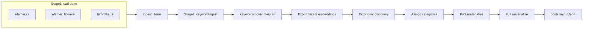
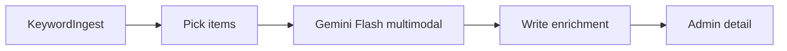

# Multi-stage content loader (master)

Single source of truth for the ingest → LLM → taxonomy → public posts pipeline. (Former “Stage 2 LLM analysis” plan is merged here.)

## Guiding principle: keywords first, taxonomy later

Do **not** lock categories (`ritualy` / `himmelhaus` / `umeni`) during import.

1. **Complete load** of all sources into ingest
2. **Keyword + vision** — keywords, photo ratings, cover, story roles, reject/demote, alt, crop, palette, series, layoutHints
3. **Inspect the corpus** — exports, facets, clusters, embeddings
4. **Decide final category shape** — may be multi-label; may add emerging categories
5. **Assign categories** to ingest items
6. **Pilot materialize**, then full materialize (layout from photo roles)

Today’s three site sections remain provisional until taxonomy is settled.

## Pipeline



| Layer | Tables | Role |
|---|---|---|
| Imported | `ingest_items`, `ingest_item_files` | Source mirror + LLM enrichments |
| Internal | `posts`, `post_files`, `events` | After taxonomy + stage 3 |

**Interlink:** `ingest_items.postId` ↔ `posts.ingestItemId` (`ON DELETE SET NULL`).

---

## Stage 1 — load (done)

See [`.cursor/rules/ingest.mdc`](.cursor/rules/ingest.mdc) and [`.cursor/rules/jobs.mdc`](.cursor/rules/jobs.mdc).

- Sources → `ingest_items` / `ingest_item_files` only (not public `posts`)
- GCS `gs://efemer/{DEV|PROD}/…`, contentHash dedupe, quality flags
- efemer.cz **`sourceSlot`**: `pre_copy` | `post_copy`; **`galleryIndex`**
- Instagram slots = `unknown`
- Katu jobs + `./bin/job` (TTY); `jobs:kill`; Ctrl+C watchdog under `-T`
- Admin list/detail at `/admin/ingest`
- Unique `(source, sourceKey)` with normalized keys (no leading `/`)

### Corpus note (efemer.cz)

Typical diary: short Czech text + many photos. Original HTML often has a small gallery **before** `section.copy` (lead prior) and a large gallery **after** (support).

---

## Photo story roles (for layout)

Orthogonal to cover and demote. Cover may also be `lead`; demoted → `role=skip`.

| Role | Meaning | Layout |
|---|---|---|
| `lead` | Integral story beat | Large / interleaved; often `pre_copy` |
| `support` | Atmosphere / sequence | Gallery after text |
| `detail` | Close-up / material | Quieter gallery / lightbox |
| `context` | Establishing place | Buried or paired |
| `skip` | Blurry / meme / dup / off-brand | Omitted publicly |

**Classifier signals:** (1) `sourceSlot`, (2) vision + body, (3) rating ≠ automatic lead, (4) near-dup demote, (5) Instagram order as weak prior.

**`layoutHints` / later `posts.layoutJson` patterns:** `hero_text_gallery`, `text_lead_gallery`, `gallery_essay`, `single`.

---

## Schema

### Already present

`ingest_items`: source keys, title, postedAt, bodyHtml, contentHash, status, kind, keywords, themes, entities, qualityFlags, categories, classificationRaw, embedding, duplicateOfId, postId, eventId.

`ingest_item_files`: storageFileId, position, caption, keywords, contentHash, sourceSlot, galleryIndex.

### Stage 2 enrichment migration (`IngestEnrichmentSchema`)

**`ingest_items` add:** `coverFileId`, `coverRationale`, `coverLocked`, `seriesKey`, `palette`, `layoutHints`, `enrichmentVersion`, `enrichedAt`.

**`ingest_item_files` add:** `rating`, `isCover`, `role`, `roleRationale`, `roleLocked`, `altText`, `orientation`, `focalCrop`, `demote`.

On materialize: copy onto `posts` / `post_files`; write `layoutJson`; respect locks.

---

## Stage 2 — KeywordIngest (next to build)

### Goal

`loaded` → `keyworded` with searchable keywords + layout-ready photo metadata. **No taxonomy / materialize.**

### Architecture



- **Model:** `gemini-3.8-flash` via `generativelanguage.googleapis.com` REST (no new Composer package)
- **Secret:** `Secrets::GEMINI_API_KEY` (`gemini-api-key` in GSM); local fallback `.secret/gemini.api`; fail fast if missing
- **Per item:** one multimodal call — title + ~4k stripped body + up to **12** images (GCS → GD resize ≤1024 → JPEG ~80 → base64)
- **Skip** videos / failed downloads; note missing positions in prompt
- **Priors:** qualityFlags, sourceSlot, galleryIndex, position

### Classes

| Class | Role |
|---|---|
| `App\Classes\ThirdParty\Google\Gemini` | `generateContent`, 429/503 backoff |
| `App\Classes\Ingest\KeywordAnalyzer` | Prompt, images, parse JSON, apply |
| `App\Classes\Jobs\Ingest\KeywordIngest` | Katu job |

### Prompt / apply

Czech keywords + altText; English enums for roles. Output: item keywords/themes/entities/kind/cover(by position)+rationale/palette/seriesKey/layoutHints; per-file rating/role/alt/orientation/focalCrop/demote.

- demote → `role=skip`; cover among non-skip preferring lead
- Respect `coverLocked` / `roleLocked`
- Store raw JSON in `classificationRaw`; set `enrichmentVersion=kw-v1`, `enrichedAt`, `status=keyworded`
- On error: leave `loaded`, log failure, continue

### Job CLI

```bash
./bin/job jobs:run App.Classes.Jobs.Ingest.KeywordIngest -f
./bin/job jobs:run App.Classes.Jobs.Ingest.KeywordIngest --args='{"limit":5,"rekeyword":true}' -f
./bin/job jobs:run App.Classes.Jobs.Ingest.KeywordIngest --args='{"dryRun":true,"limit":1}' -f
```

Args: `limit` (default 20), `rekeyword`, `id`, `maxImages` (12), `dryRun`. Skip `keyworded` + matching `enrichmentVersion` unless rekeyword. `Signals` between items. Log token usage when present.

### Admin (light, with stage 2)

Cover badge; role + rating + alt on photos; keywords/themes; `enrichmentVersion` / `enrichedAt`. Richer pick/lock UI later (`ingest-admin-rich`).

### Smoke

One real item locally; confirm admin detail.

---

## LLM quality control (21 keyworded, 2026-10-28)

Sample: 21 items / 102 files / 127 distinct item keywords. Eval: cover **95%**, roles **100%**, pattern 5/6.

### What looks good

- Czech keywords on-brand (plants, rituals, places); per-file kw always 4–8
- `pre_copy` → `lead` perfect (21/21); roles usefully split support/detail/context
- Every item has cover + non-empty alt (~85 chars avg)
- Soft `kind` mostly sensible: wedding 8, diary 6, installation 5, workshop 1, product 1
- Themes/entities often richer than keywords (good taxonomy signal)

### Issues → prompt `kw-v3`

| Issue | Evidence | Fix |
|---|---|---|
| Cover ignores `pre_copy` for flashier later frame | *svatba Na Svatého Jana*: cover pos 4 vs expected 1 | If any `pre_copy` exists, cover ∈ pre_copy unless demoted/skip |
| `gallery_essay` overused | 16/21 patterns | Prefer `hero_text_gallery` when body nonempty + pre_copy; `gallery_essay` only thin_text / image-led |
| `kind=diary` for funeral/gift/portrait | *Poslední květy…*, *pro mámu*, *Filip* | Add `mourning` / `gift` / `portrait` (or map mourning→ritual) |
| `kind=product` for named bouquet | *Anna* | Prefer `bouquet` / `commission`; reserve product for shop-like |
| Demote never used | 0 demoted; ratings 0.7–0.9 | Encourage demote for blurry/dup; widen rating spread |
| Keyword noise | `florisitika`; Festival casing | Normalize case; ask model to spell-check Czech |
| Dual leads | Jana lead at 1 and 4 | Extra leads OK; cover still from pre_copy |
| Rating inflation | mean 0.81 | Calibrate: 0.9+ rare hero; ~0.5 filler |

### Taxonomy implications (don’t lock yet)

Emerging facets: occasion (svatba/smuteční/workshop/instalace/dar), material, place, medium. Site sections still provisional until full corpus + co-occurrence review.

### Eval + export (done)

- Eval JSON: `app/Resources/Ingest/eval/covers.json`, `roles.json` — job `EvaluateKeywords`
- Export: `ExportCorpus` → `tmp/ingest/exports/`; admin kind facets + search

---

## Later stages

### Next

1. **`kw-v3` prompt + apply rules**; bump `ENRICHMENT_VERSION`
2. Rekeyword eval set; re-run EvaluateKeywords (target cover ≥98%)
3. Batch remaining `loaded` (~86); re-export
4. Embeddings / dedup → taxonomy pause → materialize → rich admin

No KeywordIngest prod cron until kw-v3 eval is solid and demote appears on real junk frames.

---

## Implement order

1. ~~Stage 1 + KeywordIngest + light admin~~
2. ~~Eval sets + corpus export + facets~~
3. **QC prompt bump `kw-v3` + re-eval**
4. Finish keywording remaining loaded items
5. Embeddings / dedup
6. Taxonomy pause → assign
7. Materialize
8. Rich admin + rules polish
