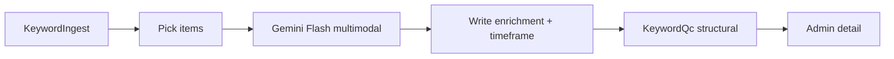

# Multi-stage content loader (master)

Single source of truth for the ingest → LLM → taxonomy → public posts pipeline. Standing ops live in [`.cursor/rules/ingest.mdc`](.cursor/rules/ingest.mdc) and [`.cursor/rules/content-model.mdc`](.cursor/rules/content-model.mdc).

## Guiding principle: keywords first, taxonomy later

Do **not** lock categories (`ritualy` / `himmelhaus` / `umeni`) during import.

1. **Complete load** of all sources into ingest
2. **Keyword + vision + timeframe + tags** — keywords, photo ratings, cover, roles, demote, alt, crop, palette, series, layoutHints, LLM `timeframe` (`startsAt` / `endsAt` / `place`), and controlled `tags` (`invitation` | `report`)
3. **Inspect the corpus** — exports, facets, clusters, embeddings
4. **Decide final category shape** — may be multi-label; may add emerging categories
5. **Assign categories** to ingest items
6. **Materialize** keyworded items → public `posts` (`invitation` = ephemeral `udalosti`; `report` = lasting work)

Today’s four site sections remain provisional until taxonomy is settled.

**LLM over regex:** categorization, date/event parsing, and invitation vs report tags are Gemini’s job (text + poster OCR). PHP/`KeywordQc` only enforce structural invariants (enums, tag allowlist, cover/role locks, typo cleanup). No invitation/kind/date heuristics in PHP. `isInvitation` is a synced cache of the `invitation` tag.

## Pipeline

```mermaid
flowchart LR
  subgraph stage1 [Stage1 load done]
    E[efemer.cz]
    F[efemer_flowers]
    H[himmlhaus]
  end
  IE[ingest_items]
  stage1 --> IE
  IE --> stage2[Stage2 KeywordIngest]
  stage2 --> KW[keywords cover roles timeframe]
  KW --> corpus[Export facets embeddings]
  corpus --> review[Taxonomy discovery]
  review --> cats[Assign categories]
  KW --> mat[MaterializePosts]
  cats --> mat
  mat --> posts[posts layoutJson.parts]
  posts --> pub[Public site + /udalosti]
```



| Layer | Tables | Role |
|---|---|---|
| Imported | `ingest_items`, `ingest_item_files` | Source mirror + LLM enrichments |
| Public | `posts`, `post_files` | After `MaterializePosts` (work + invitations) |
| Legacy | `events` | Admin-only leftover; public invites are posts |

**Interlink:** `ingest_items.postId` ↔ `posts.ingestItemId`. Legacy `ingest_items.eventId` → `events` remains in schema but is unused by the public path (`ON DELETE SET NULL`).

**Statuses:** `loaded` → `keyworded` → (`categorized`) → `materialized` (or `skipped`).

---

## Stage 1 — load (done)

See [`.cursor/rules/ingest.mdc`](.cursor/rules/ingest.mdc) and [`.cursor/rules/jobs.mdc`](.cursor/rules/jobs.mdc).

- Sources → `ingest_items` / `ingest_item_files` only (not public `posts`)
- GCS `gs://efemer/{DEV|PROD}/…`, contentHash dedupe, quality flags
- efemer.cz **`sourceSlot`**: `pre_copy` | `post_copy`; **`galleryIndex`**
- Instagram slots = `unknown`
- Katu jobs + `./bin/job` (TTY); `jobs:kill`; Ctrl+C watchdog under `-T`
- Admin list/detail at `/admin/ingest`
- Unique `(source, sourceKey)` with normalized keys (no leading `/`)
- Stage-1 stores **IG upload time** as `postedAt` only; content dates come from Stage 2 LLM

### Corpus note (efemer.cz)

Typical diary: short Czech text + many photos. Original HTML often has a small gallery **before** `section.copy` (lead prior) and a large gallery **after** (support).

---

## Photo story roles (for layout)

Orthogonal to cover and demote. Cover may also be `lead`; demoted → `role=skip`.

| Role | Meaning | Layout |
|---|---|---|
| `lead` | Integral story beat | Large / interleaved; often `pre_copy` |
| `support` | Atmosphere / sequence | Gallery after text |
| `detail` | Close-up / material | Quieter gallery / lightbox |
| `context` | Establishing place | Buried or paired |
| `skip` | Blurry / meme / dup / off-brand | Omitted publicly |

**Classifier signals:** (1) `sourceSlot`, (2) vision + body, (3) rating ≠ automatic lead, (4) near-dup demote, (5) Instagram order as weak prior.

**`layoutHints` patterns** (ingest hint) vs **`posts.layoutJson.parts`** (public body: `text` / `image` / `gallery` interleaved by `PostLayoutPlanner`). Hint enums: `hero_text_gallery`, `text_lead_gallery`, `gallery_essay`, `single`.

---

## Schema

### Already present

`ingest_items`: source keys, title, postedAt, bodyHtml, contentHash, status, kind, keywords, themes, entities, qualityFlags, categories, classificationRaw, embedding, duplicateOfId, postId, eventId (legacy).

`ingest_item_files`: storageFileId, position, caption, keywords, contentHash, sourceSlot, galleryIndex.

### Stage 2 enrichment (`IngestEnrichmentSchema`)

**`ingest_items` add:** `coverFileId`, `coverRationale`, `coverLocked`, `seriesKey`, `palette`, `layoutHints`, `enrichmentVersion`, `enrichedAt`.

**`ingest_item_files` add:** `rating`, `isCover`, `role`, `roleRationale`, `roleLocked`, `altText`, `orientation`, `focalCrop`, `demote`.

### Timeframe (`IngestTimeframeSchema`)

**`ingest_items` add:** `startsAt`, `endsAt`, `place`, `isInvitation`.

Filled only by KeywordAnalyzer `timeframe` JSON (Gemini sees caption + poster images + `postedAt` as year reference). Copied onto invitation `posts` on materialize; drives `/udalosti` and homepage hero (current invite else latest work).

On materialize: copy onto `posts` / `post_files`; write `layoutJson.parts`; respect locks. Invitations → section `udalosti` (ephemeral).

---

## Stage 2 — KeywordIngest (done locally)

### Goal

`loaded` → `keyworded` with searchable keywords + layout-ready photo metadata + **invitation timeframe**. Soft `kind` is **not** a site section.

### Soft `kind` (no `mourning`)

`diary | wedding | gift | portrait | workshop | installation | bouquet | product | other`

- **workshop** = public gathering / slavnost / pouť / walk / invite (“zveme”, “sraz”, tickets, …) — even cemetery / All Saints walks
- **gift** = named tribute / farewell / birthday bouquet (e.g. *Poslední květy pro Helenu…*)
- **diary** = personal journal / house chronicle (`@himmlhaus` dated entries are fine as diary)

### Architecture



- **Model:** `gemini-3.8-flash` via `generativelanguage.googleapis.com` REST
- **Secret:** `Secrets::GEMINI_API_KEY` (`gemini-api-key` in GSM); local fallback `.secret/gemini.api`
- **Per item:** one multimodal call — title + body + up to **12** images + **Posted at** reference
- **Output adds** `timeframe: { isInvitation, startsAt, endsAt, place }`

### Job CLI

```bash
./bin/job jobs:run App.Classes.Jobs.Ingest.KeywordIngest -f
./bin/job jobs:run App.Classes.Jobs.Ingest.KeywordIngest --args='{"limit":5,"rekeyword":true}' -f
./bin/job jobs:run App.Classes.Jobs.Ingest.KeywordIngest --args='{"id":427,"rekeyword":true}' -f
```

---

## LLM quality control

### Round 1–2 (kw-v3, efemer) — done

Eval cover/roles/patterns **100%**. Demote later appeared on IG. Typo map: `florika`→`floristika`, `košilela`→`košile`.

### Round 3–4 (IG + timeframe, 2026-10-29) — done

Mid-run notes: demote on text slides; invites mis-tagged until timeframe + kind prompt fix; then re-enrich.

### Corpus snapshot (local, 2026-10-30)

| Metric | Result |
|---|---|
| Status | **733** `keyworded` + **5** `materialized`; **0** `loaded` |
| Enrichment | all **`kw-v3`** (738) |
| Sources | efemer_cz 107 · instagram 631 |
| Soft kinds | diary 348, workshop 148, wedding 95, installation 75, gift 30, portrait 24, bouquet 16, product 2 — **no mourning** |
| Invitations | **127** `isInvitation` (121 with `startsAt`); mostly IG workshops |
| Timeframe JSON | **608** items with Gemini `timeframe` block in classificationRaw |
| Public posts | **5** pilots (Wanderlust invite + 4 lasting) |

**Examples:** Wanderlust `#427` → workshop + invite → post `#154` `/udalosti`; `@himmlhaus` Weinlese → himmelhaus diary posts.

**Taxonomy / product implications**

- Soft `kind` ≠ site section. `@himmlhaus` diary stays journal until taxonomy assigns `himmelhaus` / etc.
- **`isInvitation` + timeframe** → ephemeral invitation **posts** (not `events` table).
- Broader materialize waits on taxonomy (or deliberate pilot picks).

### Ops note

Prod Instagram archive loop remains **off**. Prefer Instaloader dump + Import when private API 429. Stage-1 re-runs are upsert/idempotent (hash skip). No KeywordIngest prod cron yet.

---

## Later stages

### Next

1. **ExportCorpus + EvaluateKeywords** (full corpus after IG finish); optional IG invite/cover eval rows
2. ~~Optional: rekeyword older items that still lack `timeframe` JSON (~130)~~ — **in progress on prod** (flagged `needs_rekeyword`, KeywordIngest `rekeyword` limit 150)
3. Embeddings / dedup → **taxonomy pause** → assign categories
4. **Broader MaterializePosts** (beyond the 5 pilots)
5. Rich ingest admin (manual cover/role locks, layout preview)
6. Optional: empty `bodyHtml` / `thin_text` (~65) — fix scraper or accept image-led
7. Drop legacy admin `events` UI when ready

### Materialize CLI (already shipped)

```bash
./bin/job jobs:run App.Classes.Jobs.Ingest.MaterializePosts -f
./bin/job jobs:run App.Classes.Jobs.Ingest.MaterializePosts --args='{"id":427}' -f
./bin/job jobs:run App.Classes.Jobs.Ingest.MaterializePosts --args='{"invitationsOnly":true}' -f
./bin/job jobs:run App.Classes.Jobs.Ingest.MaterializePosts --args='{"existingOnly":true}' -f
```

---

## Implement order

1. ~~Stage 1 + KeywordIngest + light admin~~
2. ~~Eval sets + corpus export + facets~~
3. ~~QC prompt bump `kw-v3` + re-eval~~
4. ~~Finish efemer.cz keywording~~
5. ~~IG stage-1 Instaloader~~
6. ~~LLM timeframe + drop mourning + invite re-enrich~~
7. ~~Finish IG KeywordIngest~~
8. ~~Post materialize pilots (unified posts; invitations ephemeral on `/udalosti`)~~
9. **Re-export / eval** → embeddings / dedup
10. Taxonomy pause → assign → broader materialize
11. Rich admin; drop legacy `events` UI; optional efemer bodyHtml fix
