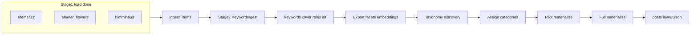
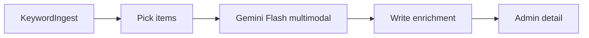

# Multi-stage content loader (master)

Single source of truth for the ingest → LLM → taxonomy → public posts pipeline. (Former “Stage 2 LLM analysis” plan is merged here.)

## Guiding principle: keywords first, taxonomy later

Do **not** lock categories (`ritualy` / `himmelhaus` / `umeni`) during import.

1. **Complete load** of all sources into ingest
2. **Keyword + vision** — keywords, photo ratings, cover, story roles, reject/demote, alt, crop, palette, series, layoutHints
3. **Inspect the corpus** — exports, facets, clusters, embeddings
4. **Decide final category shape** — may be multi-label; may add emerging categories
5. **Assign categories** to ingest items
6. **Pilot materialize**, then full materialize (layout from photo roles)

Today’s three site sections remain provisional until taxonomy is settled.

## Pipeline



| Layer | Tables | Role |
|---|---|---|
| Imported | `ingest_items`, `ingest_item_files` | Source mirror + LLM enrichments |
| Internal | `posts`, `post_files`, `events` | After taxonomy + stage 3 |

**Interlink:** `ingest_items.postId` ↔ `posts.ingestItemId` (`ON DELETE SET NULL`).

---

## Stage 1 — load (done)

See [`.cursor/rules/ingest.mdc`](.cursor/rules/ingest.mdc) and [`.cursor/rules/jobs.mdc`](.cursor/rules/jobs.mdc).

- Sources → `ingest_items` / `ingest_item_files` only (not public `posts`)
- GCS `gs://efemer/{DEV|PROD}/…`, contentHash dedupe, quality flags
- efemer.cz **`sourceSlot`**: `pre_copy` | `post_copy`; **`galleryIndex`**
- Instagram slots = `unknown`
- Katu jobs + `./bin/job` (TTY); `jobs:kill`; Ctrl+C watchdog under `-T`
- Admin list/detail at `/admin/ingest`
- Unique `(source, sourceKey)` with normalized keys (no leading `/`)

### Corpus note (efemer.cz)

Typical diary: short Czech text + many photos. Original HTML often has a small gallery **before** `section.copy` (lead prior) and a large gallery **after** (support).

---

## Photo story roles (for layout)

Orthogonal to cover and demote. Cover may also be `lead`; demoted → `role=skip`.

| Role | Meaning | Layout |
|---|---|---|
| `lead` | Integral story beat | Large / interleaved; often `pre_copy` |
| `support` | Atmosphere / sequence | Gallery after text |
| `detail` | Close-up / material | Quieter gallery / lightbox |
| `context` | Establishing place | Buried or paired |
| `skip` | Blurry / meme / dup / off-brand | Omitted publicly |

**Classifier signals:** (1) `sourceSlot`, (2) vision + body, (3) rating ≠ automatic lead, (4) near-dup demote, (5) Instagram order as weak prior.

**`layoutHints` / later `posts.layoutJson` patterns:** `hero_text_gallery`, `text_lead_gallery`, `gallery_essay`, `single`.

---

## Schema

### Already present

`ingest_items`: source keys, title, postedAt, bodyHtml, contentHash, status, kind, keywords, themes, entities, qualityFlags, categories, classificationRaw, embedding, duplicateOfId, postId, eventId.

`ingest_item_files`: storageFileId, position, caption, keywords, contentHash, sourceSlot, galleryIndex.

### Stage 2 enrichment migration (`IngestEnrichmentSchema`)

**`ingest_items` add:** `coverFileId`, `coverRationale`, `coverLocked`, `seriesKey`, `palette`, `layoutHints`, `enrichmentVersion`, `enrichedAt`.

**`ingest_item_files` add:** `rating`, `isCover`, `role`, `roleRationale`, `roleLocked`, `altText`, `orientation`, `focalCrop`, `demote`.

On materialize: copy onto `posts` / `post_files`; write `layoutJson`; respect locks.

---

## Stage 2 — KeywordIngest (next to build)

### Goal

`loaded` → `keyworded` with searchable keywords + layout-ready photo metadata. **No taxonomy / materialize.**

### Architecture



- **Model:** `gemini-3.8-flash` via `generativelanguage.googleapis.com` REST (no new Composer package)
- **Secret:** `Secrets::GEMINI_API_KEY` (`gemini-api-key` in GSM); local fallback `.secret/gemini.api`; fail fast if missing
- **Per item:** one multimodal call — title + ~4k stripped body + up to **12** images (GCS → GD resize ≤1024 → JPEG ~80 → base64)
- **Skip** videos / failed downloads; note missing positions in prompt
- **Priors:** qualityFlags, sourceSlot, galleryIndex, position

### Classes

| Class | Role |
|---|---|
| `App\Classes\ThirdParty\Google\Gemini` | `generateContent`, 429/503 backoff |
| `App\Classes\Ingest\KeywordAnalyzer` | Prompt, images, parse JSON, apply |
| `App\Classes\Jobs\Ingest\KeywordIngest` | Katu job |

### Prompt / apply

Czech keywords + altText; English enums for roles. Output: item keywords/themes/entities/kind/cover(by position)+rationale/palette/seriesKey/layoutHints; per-file rating/role/alt/orientation/focalCrop/demote.

- demote → `role=skip`; cover among non-skip preferring lead
- Respect `coverLocked` / `roleLocked`
- Store raw JSON in `classificationRaw`; set `enrichmentVersion=kw-v1`, `enrichedAt`, `status=keyworded`
- On error: leave `loaded`, log failure, continue

### Job CLI

```bash
./bin/job jobs:run App.Classes.Jobs.Ingest.KeywordIngest -f
./bin/job jobs:run App.Classes.Jobs.Ingest.KeywordIngest --args='{"limit":5,"rekeyword":true}' -f
./bin/job jobs:run App.Classes.Jobs.Ingest.KeywordIngest --args='{"dryRun":true,"limit":1}' -f
```

Args: `limit` (default 20), `rekeyword`, `id`, `maxImages` (12), `dryRun`. Skip `keyworded` + matching `enrichmentVersion` unless rekeyword. `Signals` between items. Log token usage when present.

### Admin (light, with stage 2)

Cover badge; role + rating + alt on photos; keywords/themes; `enrichmentVersion` / `enrichedAt`. Richer pick/lock UI later (`ingest-admin-rich`).

### Smoke

One real item locally; confirm admin detail.

---

## LLM quality control

### Round 1 (pre–kw-v3) — addressed

Cover sometimes ignored `pre_copy`; `diary`/`product` overused; `gallery_essay` default; typos; rating inflation. Fixed in **kw-v3** prompt + apply rules.

### Round 2 (kw-v3, 21 items, 2026-10-28 afternoon)

| Metric | Result |
|---|---|
| Status | 21 `keyworded` / `kw-v3`, 86 `loaded` |
| Eval cover | **100%** (19/19 scored; *Svatba Mlhových* not in batch yet) |
| Eval roles | **100%** (16/16) |
| Eval patterns | **5/5** pass |
| Cover slot | **21/21 pre_copy** (0 post_copy covers) |
| pre_copy → lead | **21/21** |
| Demote | still **0** (corpus may simply lack junk frames) |
| Rating mean | **0.75** (was ~0.81) — improved |

**Kinds now useful:** wedding 6, installation 5, bouquet 4, portrait 2, gift 2, workshop 1, mourning 1. Examples look right (*Poslední květy* → mourning, *pro mámu* → gift, *Filip*/*čemeřice* → bouquet). Mild ambiguity: *Barbora* as bouquet vs wedding — acceptable for soft kind.

**Keywords:** mostly clean Czech; one leak `přírodní florika` (typo map should add `florika`→`floristika`). Festival casing normalized to lowercase in v3 runs.

**Layout patterns:** `gallery_essay` 16 / `single` 4 / `hero_text_gallery` 1. **Not a prompt bug** — 20/21 keyworded items are `thin_text` with **empty `bodyHtml`**. Only *masopustní veselky* has body (771 chars) → correctly `hero_text_gallery`. Site-wide: **59/107** efemer items have empty body; **48** have text (mostly older posts not yet keyworded). So pattern diversity will improve as long-copy posts get enriched — and/or after a stage-1 body extraction fix.

### Round 3 (kw-v3 + Instagram mid-run, 2026-10-29)

| Metric | Result |
|---|---|
| Status | **107** efemer + **64** IG `keyworded` / `kw-v3`; **567** IG still `loaded` |
| Eval cover / roles / patterns | **100%** (20/20, 17/17, 6/6) — golden set still efemer-heavy |
| Cover | every keyworded item has `coverFileId`; efemer covers **106/107 pre_copy** |
| Demote | **54** files demoted (was 0) — IG carousel **text slides**, blur, missing thumbs |
| Rating mean | **~0.71** |
| Keywords | ~8.7/item; mostly clean Czech; new typo leak `košilela` |
| seriesKey | almost unused (2/171) — ignore until embeddings |

**Kind split (keyworded):**

| Source | Notable |
|---|---|
| efemer_cz | wedding 35, diary 25, gift 13, installation/bouquet/portrait ~10 each, mourning 3 |
| `@efemer_flowers` | workshop 12, diary 7, installation 4 — looks usable |
| `@himmlhaus` | **38/38 diary** so far — soft-label collapse; many are events/rituály by caption |

**Layout patterns:** efemer still `gallery_essay`/`hero_text_gallery` (thin_text body gap). IG captions → mostly `text_lead_gallery` (58/65) — expected and useful.

**Taxonomy implications (updated)**

- Soft `kind` is a hint, not a section. Especially do **not** map himmlhaus `diary` → a site section.
- Emerging facets still: occasion / material / place / medium; IG adds **event/workshop** language in captions (Kupalo, Volání na stromy, …) — consider an event-ish facet when assigning, separate from public `events` entities.
- Demote on text slides is good for materialize; keep watching false demotes of real photos.

### Ops note

Prod Instagram archive loop remains **off**. Prefer Instaloader dump + Import when private API 429. Stage-1 re-runs are upsert/idempotent (hash skip).

---

## Later stages

### Next

1. ~~Instagram stage-1 via Instaloader~~ — **400** + **231** in ingest
2. **Finish KeywordIngest** on remaining IG `loaded` (~567)
3. Typo map: `košilela`→`košile` (and re-QC / needs_rekeyword if it spreads)
4. After IG done: **ExportCorpus + EvaluateKeywords**; optional small IG cover/role eval rows
5. Decide whether himmlhaus kind prompt needs a bump (event/workshop priors) — only if diary collapse holds on full account
6. Embeddings / dedup → taxonomy pause → materialize
7. Optional: empty `bodyHtml` / `thin_text` on efemer.cz (still ~59)

No KeywordIngest prod cron yet.

---

## Implement order

1. ~~Stage 1 + KeywordIngest + light admin~~
2. ~~Eval sets + corpus export + facets~~
3. ~~QC prompt bump `kw-v3` + re-eval~~
4. ~~Finish efemer.cz keywording~~ (107 kw-v3; eval 100%)
5. ~~IG stage-1 Instaloader~~
6. **Finish IG KeywordIngest** (in progress) + typo/kind watch items
7. Re-export / eval → **embeddings / dedup**
8. Taxonomy pause → assign
9. Materialize
10. Rich admin + rules polish; optional efemer bodyHtml fix
